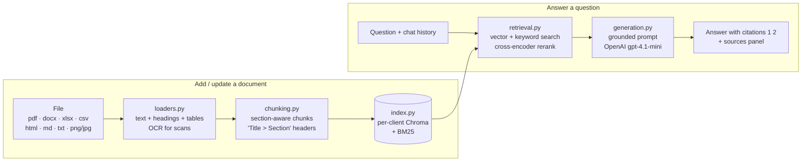

# AI Knowledge Assistant

A retrieval-augmented generation (RAG) assistant that answers questions **only from your own documents** and cites the sources it used. Upload PDFs, Word files, spreadsheets, web pages, Markdown, text or scanned images, then ask questions in a chat UI.

The demo knowledge base is **Insurellm**, a fictional insurance-tech company (`knowledge-base/`, 76 Markdown files). Answers are written by OpenAI `gpt-4.1-mini`, at roughly $0.001–0.0015 per question. Everything else is free: local embeddings, reranker and OCR, plus the Groq free tier for the optional query helper and the evaluation judge.

## How it works



| Module (`answer_engine/`) | Role |
|---|---|
| `loaders.py` | Reads each file type into sections that keep headings and tables. Scanned PDF pages and images go through local OCR (RapidOCR). |
| `chunking.py` | Splits sections into ~1200-character chunks. Never mixes two sections in one chunk, keeps table rows whole, and prefixes each chunk with its `Title > Section` path. |
| `index.py` | One Chroma database per client in `engine_data/<client_id>/` (local `bge-small-en-v1.5` embeddings), plus a BM25 keyword index. Adding or deleting one document touches only that document's chunks. |
| `retrieval.py` | Hybrid vector + BM25 search, a local cross-encoder rerank, and extra chunks from other documents for "how many / which / list" questions. |
| `generation.py` | Answers only from the retrieved excerpts and only what was asked. Cites excerpts as `[1]`, states calculations only when the numbers support them exactly, says so when the information isn't in the documents, and ignores instructions embedded in documents. |
| `pipeline.py` | Public API and CLI: `add_file`, `add_folder`, `remove_document`, `list_documents`, `answer_question`, `stream_answer`. |
| `config.py` | Every model name and tuning setting in one place. |

## Install

Requires Python 3.13, an [OpenAI API key](https://platform.openai.com/api-keys) (for answers), and a free [Groq API key](https://console.groq.com/keys) (for the evaluation judge and the optional query helper).

```powershell
cd "AI knowledge Assisstant"
python -m venv .venv
.\.venv\Scripts\Activate.ps1          # macOS/Linux: source .venv/bin/activate
pip install -r requirements.txt
python -m answer_engine.loaders --prepare-ocr   # one-time OCR model download
```

Create `.env` in this folder (never commit it):

```
OPENAI_API_KEY=your_openai_key
GROQ_API_KEY=your_groq_key
```

To change models (e.g. back to a free Groq model), edit `ANSWER_MODEL` in `answer_engine/config.py`.

## Run

```powershell
python -m answer_engine.pipeline ingest knowledge-base   # index the demo documents (first run only)
python app_engine.py                                     # opens the UI at http://127.0.0.1:7860
```

The UI has two tabs:
- **Chat**: answers stream on the left, and the sources used appear on the right.
- **Documents**: upload, list and delete documents.

## Managing documents

| Task | In the UI (Documents tab) | From the command line |
|---|---|---|
| **Add** | Choose files, then click **Add to index** | `python -m answer_engine.pipeline ingest <folder>` |
| **Update** | Upload a file with the **same file name**. The old version's chunks are replaced. | Re-run `ingest` on the folder. Only changed files are re-indexed (by content hash). |
| **Delete** | Pick it in **Delete a document**, then click **Delete** | `python -c "from answer_engine import pipeline; pipeline.remove_document('products/Carllm.md')"` |
| **List** | The table on the Documents tab | `python -c "from answer_engine import pipeline; print(pipeline.list_documents())"` |

Notes:
- **Document IDs:** UI uploads use the **file name**, while `ingest` uses the **path relative to the folder** (e.g. `products/Carllm.md`). To update a document, use the same route you added it with. Otherwise it is indexed twice.
- **Deleted files:** `ingest` adds and updates but never deletes. Remove documents whose files you deleted with **Delete** or `remove_document`.
- **Unchanged files:** re-uploading an identical file is a no-op.

Python API:

```python
from answer_engine import pipeline

pipeline.add_file("handbook.pdf", doc_id="handbook.pdf")
answer, sources = pipeline.answer_question("What is the leave policy?")
pipeline.remove_document("handbook.pdf")
```

All functions take an optional `client_id`. Each client has a separate database, ready for the planned multi-client platform.

## Tests and evaluation

```powershell
pip install -r requirements-dev.txt
pytest answer_engine/tests                                                   # loaders, chunking, index

python -m evaluation.eval all --impl engine --retrieval-only --label run1    # retrieval metrics, local and free
python -m evaluation.eval all --impl engine --split tune --label run1        # answers scored by an LLM judge
python -m evaluation.failures evaluation/results/run1.json                   # list the failed answers
```

`evaluation/tests.jsonl` holds 150 questions with reference answers. Tune on `--split tune` (100 questions) and report on `--split holdout` (50) to avoid overfitting.

## Project layout

```
answer_engine/      the RAG engine (above)
app_engine.py       Gradio UI on answer_engine
evaluation/         test set, eval CLI, failure report, test generator
knowledge-base/     demo documents (Insurellm)
implementation/     original basic pipeline (legacy, used by app.py)
pro_implementation/ earlier advanced pipeline (legacy)
engine_data/        generated indexes (gitignored)
```
