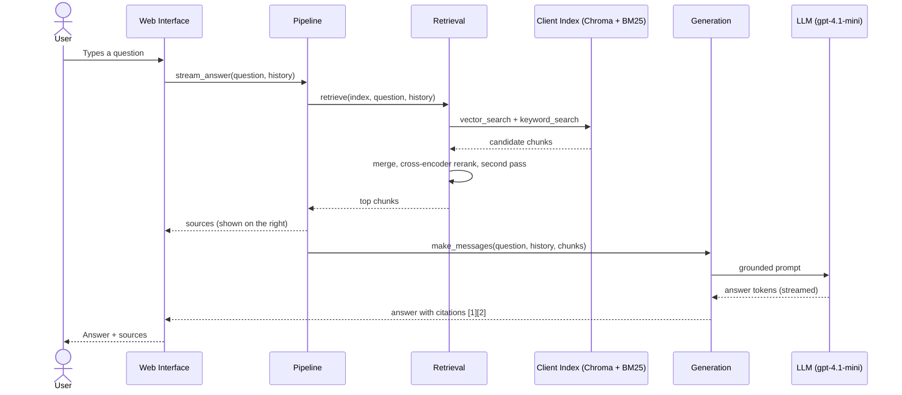
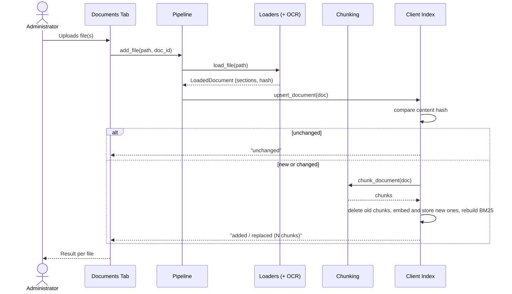
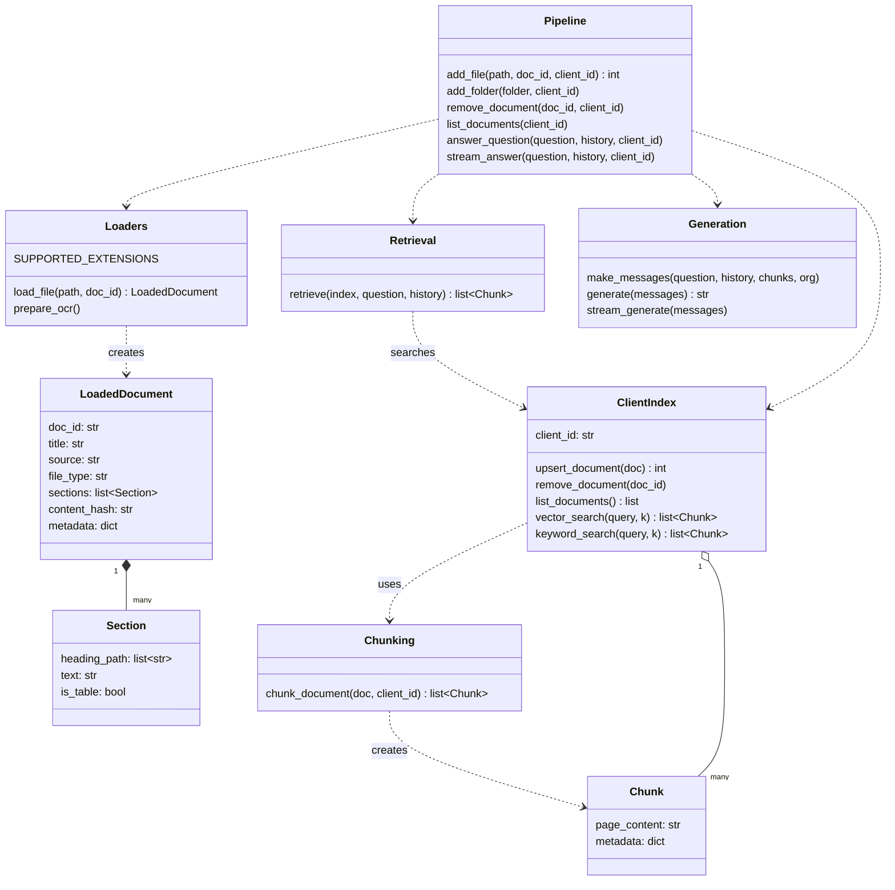
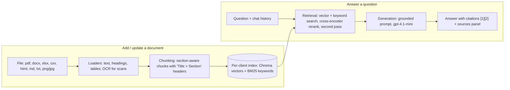

# Project Report — Content Draft

> **Status:** content draft, written to follow the structure of the sample report (`MAHREEN MAJOR PROJECT DOC.pdf`).
> Fields in `[[double brackets]]` are waiting for your details (names, roll numbers, guide, title confirmation).
> All numbers in this draft come from the project's own saved test results (`ai-knowledge-assistant/evaluation/results/`).

---

## Title page

A Major Project Report on

**“[[AI KNOWLEDGE WORKER: A DOCUMENT-BASED RAG ASSISTANT]]”**

Submitted to **[[OSMANIA UNIVERSITY, Hyderabad]]**
in partial fulfillment of the requirements for the award of the degree of
**[[BACHELOR OF ENGINEERING / BACHELOR OF TECHNOLOGY]]** in **COMPUTER SCIENCE AND ENGINEERING**

Submitted by
[[STUDENT NAME 1]] — [[ROLL NO 1]]
[[STUDENT NAME 2]] — [[ROLL NO 2]]

Under the guidance of
**[[GUIDE NAME]]**, [[Designation]]

DEPARTMENT OF COMPUTER SCIENCE AND ENGINEERING
**[[COLLEGE NAME]]**, [[City]]
[[2026–2027]]

---

## Certificate

This is to certify that the Major Project entitled **“[[Project Title]]”** is being submitted by the following students:

[[STUDENT NAME 1]] — [[ROLL NO 1]]
[[STUDENT NAME 2]] — [[ROLL NO 2]]

They have presented the project work during the academic year [[2026–2027]] in partial fulfillment of the requirements for the award of [[degree]] in Computer Science and Engineering from [[University]]. This is a bonafide record of work carried out by them under our guidance and supervision. The results of the investigation enclosed with this report have been verified and found to be satisfactory.

Internal Supervisor  Project Coordinator & Head of the Department  External Examiner

---

## Declaration

We hereby declare that the project work entitled **“[[Project Title]]”**, submitted to the Department of Computer Science and Engineering of [[College Name]], affiliated to [[University]], in partial fulfillment of the requirements for the award of the degree of [[degree]] in Computer Science and Engineering, is a bonafide work done by us and has not been submitted elsewhere for the award of any degree.

[[STUDENT NAME 1]] — [[ROLL NO 1]]
[[STUDENT NAME 2]] — [[ROLL NO 2]]

---

## Acknowledgement

The successful completion of any task is incomplete without mentioning the people who made it possible and whose guidance and encouragement helped us throughout the project.

We express our sincere gratitude to [[Principal's name]], Principal, for his constant support and for providing the facilities needed for this work.

We thank [[Dean / Professor name]], [[designation]], for sharing his experience and knowledge, which helped us understand real-world software development.

We are deeply grateful to our internal guide, [[Guide name]], [[designation]], for valuable suggestions, timely feedback and continuous encouragement that shaped this project.

We also thank all the faculty members of the Department of Computer Science and Engineering, our families and our friends, who supported us directly or indirectly in completing this work.

[[STUDENT NAME 1]] — [[ROLL NO 1]]
[[STUDENT NAME 2]] — [[ROLL NO 2]]

---

## Abstract

Organisations keep their knowledge in many documents — policies, contracts, product manuals, employee records, spreadsheets and scanned papers. Finding a specific fact in them is slow, and general-purpose AI chatbots cannot answer reliably because they have never seen an organisation's private documents and tend to invent answers ("hallucinate").

This project builds an **AI Knowledge Assistant** based on **Retrieval-Augmented Generation (RAG)**. Users upload their documents (PDF, Word, Excel, CSV, HTML, Markdown, text, and scanned PDFs or images), and the system reads them, splits them into meaningful sections, and indexes them for both meaning-based (vector) and keyword (BM25) search. When a user asks a question in natural language, the system retrieves the most relevant passages, re-ranks them with a cross-encoder, performs a second search for two-step questions, and asks a Large Language Model to answer **only from those passages**, citing each source as [1], [2]. If the documents do not contain the answer, the assistant says so instead of guessing. It also ignores malicious instructions hidden inside uploaded documents (prompt injection).

The system was evaluated on a 150-question test set using an independent LLM judge. On 50 held-out questions that were never used for tuning, **94% of answers were judged correct** (up from 90% for the original pipeline with the same answer model), and retrieval ranking quality (MRR) improved from 0.894 to 0.931. The prototype runs locally with a web interface for chatting and managing documents, at a cost of about $0.001 per question.

**Keywords:** Retrieval-Augmented Generation, Large Language Models, Semantic Search, BM25, Cross-Encoder Re-ranking, OCR, Knowledge Management, Prompt Injection.

---

## Contents

| S.No. | Description | Page |
|---|---|---|
| | Abstract | |
| 1 | Introduction | |
| 2 | Literature Survey | |
| 3 | System Analysis | |
| 3.1 | Software Requirement Specifications (SRS) | |
| 3.2 | Use Case Diagram | |
| 3.3 | Sequence Diagram | |
| 4 | System Design | |
| 4.1 | Class Diagram | |
| 4.2 | System Architecture | |
| 5 | Implementation | |
| 5.1 | Modules and Algorithms | |
| 5.2 | Testing and Results | |
| 5.3 | Screenshots | |
| 6 | Conclusion | |
| 6.1 | Applications | |
| 6.2 | Future Scope | |
| | References | |

*(Page numbers are filled in after the Word layout is final.)*

---

# 1. INTRODUCTION

Every organisation produces large amounts of written knowledge: company policies, HR records, product descriptions, client contracts, reports and spreadsheets. Employees regularly need answers hidden inside these documents — *"What does the Professional plan cost?"*, *"Who is the technical lead for this product?"*, *"When does this contract end?"* — but finding them means opening many files and searching manually. Keyword search helps only when the user already knows the exact words used in the document.

Large Language Models (LLMs) such as GPT can answer questions in fluent natural language, but on their own they have two serious problems for organisational use: they **do not know the organisation's private documents**, and when they do not know an answer they often **produce a confident but invented one**. Retrieval-Augmented Generation (RAG) solves both problems by first *retrieving* the relevant passages from the organisation's own documents and then asking the LLM to *generate* an answer grounded only in those passages.

This project designs, builds and evaluates such a system: an AI Knowledge Assistant that reads an organisation's documents in many formats and answers questions about them accurately, with citations, and with honest "I don't know" answers when the information is missing.

## 1.1 General

The assistant works in two phases.

1. **Ingestion (adding documents).** Each uploaded file is read into text while keeping its structure (headings and tables). Scanned pages and images are converted to text with Optical Character Recognition (OCR). The text is split into section-aware chunks, each labelled with its document title and section path, and stored in a vector database (for meaning-based search) and a keyword index (for exact-term search). Every organisation ("client") has its own separate store.
2. **Question answering.** A user's question is searched in both indexes, the candidates are merged and re-ranked by a cross-encoder model, and a second search finds facts that sit in a different section or document (two-step questions). The best passages are sent to an LLM with strict instructions to answer only from them, cite them, show any calculations, and refuse to answer from outside knowledge.

The demonstration knowledge base is **Insurellm**, a fictional insurance-technology company with 76 documents (company information, 32 client contracts, 32 employee records and 8 product descriptions). The system itself contains no Insurellm-specific logic and works on any organisation's documents.

## 1.2 Objective

The objectives of the project are:

- To build an assistant that answers natural-language questions **only from an organisation's own documents**, with **citations** to the exact source passages.
- To reach **answer accuracy above 90%**, measured on questions that were not used during development, using only *general* techniques that work for any documents.
- To support the common business file types: **PDF, Word (.docx), Excel (.xlsx), CSV, HTML, Markdown, plain text, and scanned PDFs/images** (via OCR).
- To let administrators **add, replace and delete** documents, with automatic detection of unchanged files.
- To **keep each organisation's documents separate**, as the foundation for a multi-organisation platform.
- To **avoid hallucination** (say "I don't know" when the answer is not in the documents) and **resist prompt injection** (ignore instructions hidden inside uploaded documents).
- To keep **cost and response time low** (free local models wherever possible; about $0.001 per answered question).

## 1.3 Methodologies

### 1.3.1 Modules

- Document Loading Module (with OCR)
- Chunking Module
- Indexing Module (vector + keyword, per client)
- Retrieval Module (hybrid search, re-ranking, second pass)
- Answer Generation Module
- Document Management Module
- User Interface Module
- Evaluation Module

### 1.3.2 Module Description

**Document Loading Module:**
Reads each supported file type into a common structure of *sections* (heading path + text). Markdown, HTML and Word headings are preserved; tables are kept as tables; Excel sheets become one table per sheet. PDF headings are detected from font size and boldness, and PDFs without headings are split per page. Pages with no text layer (scans) and image files are read with the RapidOCR engine. Unsupported or unreadable files produce clear error messages.

**Chunking Module:**
Splits each section into chunks of about 1,200 characters with 200 characters of overlap. A chunk never mixes two sections, and table rows are never cut in half. Each chunk starts with a header such as `Homellm > Pricing`, so that even a small chunk carries the context of where it came from.

**Indexing Module:**
Stores chunks in a Chroma vector database using the local `BAAI/bge-small-en-v1.5` embedding model, and builds a BM25 keyword index over the same chunks. Each client has a separate database folder. Every document carries a content hash, so re-uploading an unchanged file is skipped, and replacing a file removes only that document's old chunks.

**Retrieval Module:**
Runs vector search and keyword search (20 candidates each), merges them, and re-ranks the candidates with the `ms-marco-MiniLM-L-6-v2` cross-encoder. The top 6 chunks are kept. For list-style questions ("how many", "which", "all") it adds chunks from additional documents. A **second-pass search** combines the titles of the top two documents with the question and searches all documents again, adding up to 3 new chunks — this finds facts that live in a different document (for example, a product's technical lead in an employee record).

**Answer Generation Module:**
Builds a prompt from the numbered chunks and the recent conversation, and asks the answer model (OpenAI `gpt-4.1-mini`, temperature 0) to answer only from the excerpts, cite them, answer only what was asked, show exact calculations, handle multi-step questions step by step, and say clearly when the information is not available. A security rule at the top of the prompt makes the model ignore any instruction found inside documents. Answers are streamed word by word.

**Document Management Module:**
Provides add, replace, list and delete operations through both the web interface and a command-line tool. Upload results are reported per file (added, replaced, unchanged, unsupported, no readable text, unreadable).

**User Interface Module:**
A web interface built with Gradio. The *Chat* tab streams the answer on the left and shows the sources used on the right (labelled "Closest matches (not used in the answer)" when the assistant could not answer). The *Documents* tab handles uploads, shows the list of indexed documents and supports deletion.

**Evaluation Module:**
Measures the system with 150 test questions in seven categories. Retrieval is scored with MRR, nDCG and keyword coverage; answers are scored 1–5 for accuracy, completeness and relevance by an independent LLM judge from a different model family. Failures are classified as *retrieval misses* or *answer mistakes*. A spending cap stops paid evaluation runs automatically.

---

# 2. LITERATURE SURVEY

## 2.1 Existing System

Today, employees usually find organisational information in one of these ways:

1. **Manual browsing** of shared folders and document management systems.
2. **Keyword search** (for example, file-explorer search or an intranet search box), which only finds documents containing the exact words typed.
3. **General-purpose AI chatbots**, which answer fluently but have no access to the organisation's private documents, or which are given a whole document pasted into the chat.
4. **Basic RAG prototypes**, which retrieve a few passages by vector similarity only and pass them to an LLM.

### 2.1.1 Existing System Disadvantages

- Manual browsing and keyword search are **slow** and fail when the user does not know the exact wording.
- General chatbots **hallucinate**: without the right source they invent plausible but false answers, and they give **no citations** to verify.
- Pasting documents into a chatbot does not scale beyond a few files and risks leaking private data.
- Basic RAG prototypes support only plain text, **miss facts spread across two documents**, retrieve poorly for exact names and numbers (vector search only), and are rarely **measured** for accuracy.
- Most tools do not handle **scanned documents** and do not defend against **instructions hidden inside documents**.

## 2.2 Proposed System

The proposed system is a RAG-based knowledge assistant that combines **hybrid retrieval** (meaning-based vector search plus exact keyword search), **cross-encoder re-ranking**, a **second-pass search** for two-step questions, and **strictly grounded answer generation** with citations. It reads all common office file types and scanned documents, keeps each organisation's documents in a separate store, and was developed with a measure-before-and-after discipline on a fixed test set with a held-out portion for honest reporting.

### 2.2.1 Proposed System Advantages

- Answers in natural language with **citations** that can be checked.
- **Says "I don't know"** when the documents do not contain the answer, instead of guessing.
- **94% answer accuracy** on held-out test questions.
- Supports **PDF, Word, Excel, CSV, HTML, Markdown, text and scanned documents**.
- Documents can be **added, replaced and deleted** at any time; unchanged files are skipped.
- **Separate storage per organisation**, ready for a multi-client platform.
- **Resists prompt injection** from uploaded documents.
- **Low cost** (about $0.001 per question) — embeddings, re-ranking and OCR run locally for free.

## 2.3 Related Work

- **Retrieval-Augmented Generation.** Lewis et al. (2020) introduced RAG, combining a retriever with a generator so that answers are conditioned on retrieved passages, improving factual accuracy on knowledge-intensive tasks. This project follows the same retrieve-then-generate principle.
- **Keyword ranking (BM25).** The BM25 probabilistic ranking function (Robertson and Zaragoza, 2009) remains a strong baseline for matching exact terms such as names, codes and numbers, which pure vector search can miss.
- **Dense embeddings.** Sentence-BERT (Reimers and Gurevych, 2019) showed how to produce sentence embeddings for semantic similarity search; the BGE family of embedding models (Xiao et al., 2023) used here provides strong retrieval quality at small size.
- **Re-ranking.** Nogueira and Cho (2019) showed that a BERT-based cross-encoder that reads the query and passage together re-ranks search results much more accurately than the first-stage retriever.
- **LLM-as-a-judge.** Zheng et al. (2023) showed that strong LLMs can grade answers in good agreement with human preferences, which makes large-scale automatic answer evaluation practical. This project uses a judge from a different model family than the answerer to reduce bias.
- **Prompt injection.** The OWASP Top 10 for LLM Applications lists prompt injection as the top risk; text inside retrieved documents can try to override the system's instructions. The project adds an explicit security rule and tests it.

## 2.4 Technologies Used

### 2.4.1 Python

Python 3.13 is the main language of the project. It has the richest ecosystem for AI and document processing, which allowed every part of the system — file reading, OCR, embeddings, search, LLM calls, evaluation and the web interface — to be written in one language.

### 2.4.2 Large Language Models (LLMs) and LiteLLM

The answer model is OpenAI **gpt-4.1-mini**, chosen after measurement for its accuracy at very low cost. The **LiteLLM** library gives one interface to many LLM providers, so the model can be changed by editing a single setting. Free **Groq**-hosted open models are used for the evaluation judge (`qwen3.8-27b`) and an optional query helper (`gpt-oss-20b`).

### 2.4.3 Embeddings and Re-ranking (Sentence-Transformers)

The **sentence-transformers** library runs two small models locally and free of charge: `BAAI/bge-small-en-v1.5` turns text into 384-dimensional vectors for semantic search, and `cross-encoder/ms-marco-MiniLM-L-6-v2` re-ranks candidate passages.

### 2.4.4 Vector Database (ChromaDB) and Keyword Search (rank-bm25)

**ChromaDB** stores chunks and their embeddings on disk, one database per client. **rank-bm25** provides the BM25 keyword index used alongside vector search.

### 2.4.5 Document Processing and OCR

**pypdf** and **pypdfium2** read PDFs, **python-docx** reads Word files, **openpyxl** reads Excel files and **BeautifulSoup** reads HTML. **RapidOCR** (on ONNX Runtime) with **OpenCV** reads text from scanned pages and images, entirely offline.

### 2.4.6 Gradio (User Interface)

**Gradio 5.50** is used to build the web interface quickly in Python: a streaming chat window, a sources panel, file upload and a document table.

### 2.4.7 Pydantic, Tenacity and Pytest

**Pydantic** defines the shared data structures (document, section, chunk). **Tenacity** retries LLM calls automatically when a rate limit is hit. **Pytest** runs 111 automated tests for loading, chunking and indexing.

### 2.4.8 Git and GitHub

All work is version-controlled with **Git** and pushed to **GitHub**, with one small commit per logical change.

---

# 3. SYSTEM ANALYSIS

## 3.1 Software Requirement Specifications (SRS)

### 3.1.1 Introduction

**Purpose.** This SRS describes the requirements of the AI Knowledge Assistant, a system that answers questions from an organisation's own documents using Retrieval-Augmented Generation.

**Document Conventions.** Requirements are grouped by feature and numbered. Technical terms (chunk, embedding, re-ranking, MRR) are explained where they first appear.

**Intended Audience and Reading Suggestions.** The document is intended for the project guide, examiners, developers and future maintainers. Readers new to the topic should read Chapter 1 and Section 3.1.2 first; developers should continue with Chapters 4 and 5.

**Project Scope.** In this phase the system covers document ingestion for all common file types (including OCR), hybrid retrieval with re-ranking, grounded answer generation with citations, document management, a web interface and a complete evaluation harness, demonstrated on a single organisation. User accounts, organisation administrators and a multi-organisation web platform are planned for the next phase (Section 6.2).

**References.** See the References section at the end of this report.

### 3.1.2 Overall Description

**Product Perspective.**
The system is a self-contained application. Its core is a Python *answer engine* with a small public interface (add a file, remove a document, list documents, answer a question). The current web interface uses this interface directly; a future web platform will call the same engine through an API.

**Product Features.**
- Upload and index documents in nine formats, including scans and images.
- Ask questions in natural language and receive streamed answers with citations.
- See the exact source passages used for each answer.
- Replace or delete documents; unchanged uploads are skipped automatically.
- Honest "information not available" answers and protection against prompt injection.
- Separate document store per organisation.
- Automatic evaluation of accuracy with a cost cap.

**User Classes and Characteristics.**
- *Employees / end users* ask questions and read answers and sources. No technical knowledge is required.
- *Administrators* upload, replace and delete documents.
- *Platform owner / developer* configures models, runs evaluations and maintains the system.

**Operating Environment.**
Windows, Linux or macOS with Python 3.13; a modern web browser; an internet connection for the answer model API. About 2 GB of RAM is needed for the local models.

**Design and Implementation Constraints.**
- Only general techniques are allowed: nothing may be hard-coded for particular documents, because each organisation uploads its own files.
- Cost must stay low: local models are used wherever possible and every paid model name is kept in one configuration file.
- Free-tier API limits (requests and tokens per day) restrict how often large evaluations can run.
- The embedding model used at indexing time and at question time must be the same.

**User Documentation.**
A README describes installation, running the app, managing documents, the Python interface and running tests and evaluations.

**Assumptions and Dependencies.**
- Documents contain selectable text or reasonably clear scans; handwriting is not supported.
- Documents are mainly in English (the embedding model is English).
- The OpenAI API (answers) and Groq API (evaluation judge) are reachable, with valid keys stored in a local `.env` file.

### 3.1.3 System Features

**System Feature 1 — Multi-format Document Ingestion.**
The system accepts `.pdf, .docx, .xlsx, .csv, .html/.htm, .md/.markdown, .txt, .png, .jpg/.jpeg`. It preserves headings and tables, detects headings in PDFs, applies OCR to pages without a text layer and to images, chunks the text section by section, and indexes it. Re-uploading an identical file is skipped (content hash); uploading a changed file with the same name replaces the old version.

**System Feature 2 — Question Answering with Citations.**
For each question the system retrieves passages with hybrid search, re-ranks them, runs a second-pass search for multi-step questions, and generates an answer only from those passages with numbered citations. The answer streams to the user and the sources are displayed beside it.

**System Feature 3 — Hallucination and Injection Safeguards.**
If the passages do not contain the answer, the system replies that the information is not available and labels the displayed passages as "closest matches (not used)". Instructions embedded in documents are ignored.

**System Feature 4 — Document Management.**
List, add, replace and delete documents from the web interface or the command line, per organisation.

**System Feature 5 — Evaluation.**
Retrieval and answer quality are measured on a 150-question test set, with a tune/hold-out split, per-category reports, failure analysis and a spending cap.

### 3.1.4 External Interface Requirements

**User Interfaces.** A browser-based interface with two tabs: *Chat* (conversation on the left, sources on the right) and *Documents* (upload area, results per file, document table, delete control).

**Hardware Interfaces.** A standard PC or server: Intel Core i3 or higher, 8 GB RAM recommended (minimum 4 GB), about 5 GB of free disk space for the environment and models.

**Software Interfaces.** Python 3.13 libraries (Gradio, ChromaDB, sentence-transformers, rank-bm25, LiteLLM, pypdf, python-docx, openpyxl, BeautifulSoup, RapidOCR); the OpenAI API for answers; the Groq API for the evaluation judge.

**Communications Interfaces.** The browser talks to the local Gradio server over HTTP; the server calls the LLM APIs over HTTPS with JSON payloads. API keys are read from a local `.env` file and never stored in code.

### 3.1.5 Other Non-functional Requirements

**Performance Requirements.** An answer should begin within a few seconds. Retrieval takes about 2.8 seconds per question on a laptop CPU (including the second pass); indexing the 76 demo documents takes under a minute; OCR takes about 2 seconds for the first scanned page.

**Safety Requirements.** The assistant must not state facts that are not in the documents and must not follow instructions found inside documents. Deleting a document requires confirmation.

**Security Requirements.** API keys are kept out of source control. Each organisation's documents are stored in a separate database. Paid evaluation runs stop automatically at a spending limit.

**Software Quality Attributes.**
- *Accuracy:* 94% of held-out answers judged correct.
- *Maintainability:* every model name and tuning setting lives in one configuration file; modules have small, documented interfaces.
- *Testability:* 111 automated tests plus the evaluation harness.
- *Portability:* runs on Windows, Linux and macOS.

### 3.1.6 Other Requirements

Exact package versions are pinned in `requirements.txt` so the environment can be rebuilt identically. The system must remain extensible to more file types, more organisations and a separate web front end.

## 3.2 UML Diagrams

Unified Modeling Language (UML) diagrams are used to describe the system before and during implementation.

### 3.2.1 Use Case Diagram

*(Figure 3.1 — to be drawn from the description below.)*

**Actors:** Employee/User, Administrator, Platform Owner, LLM Service (external).

**Use cases:**
- *Employee/User:* Ask a question · View answer with citations · View source passages · Continue a conversation (follow-up questions).
- *Administrator:* Upload documents · Replace a document · Delete a document · View indexed documents.
- *Platform Owner:* Configure models and settings · Run evaluation · View evaluation reports.
- *System (included use cases):* Read file / OCR · Chunk and index · Retrieve and re-rank · Generate grounded answer (uses LLM Service).

**Explanation:** The Employee asks questions and reads answers and their sources. The Administrator maintains the document collection. The Platform Owner configures the system and measures its accuracy. Asking a question *includes* retrieval and answer generation; uploading a document *includes* reading (with OCR when needed), chunking and indexing.

### 3.2.2 Sequence Diagram (Ask a Question)

*(Figure 3.2)*



**Explanation:** The question goes from the interface to the pipeline, which retrieves candidate chunks from both indexes of the user's organisation, re-ranks them and runs the second-pass search. The selected sources are shown immediately; the answer is then generated from them and streamed to the user with citations.

### 3.2.3 Sequence Diagram (Upload a Document)

*(Figure 3.3)*



---

# 4. SYSTEM DESIGN

## 4.1 Class Diagram

*(Figure 4.1)*



**Explanation:** `Loaders` turns a file into a `LoadedDocument` made of `Section`s. `Chunking` turns a document into `Chunk`s. `ClientIndex` stores the chunks of one organisation and searches them. `Retrieval` combines and re-ranks search results, and `Generation` writes the grounded answer. `Pipeline` is the single entry point used by the interface and the command line.

## 4.2 System Architecture

*(Figure 4.2)*



**Explanation:** The architecture has two flows. In the ingestion flow, files are read, chunked and stored in the organisation's own index. In the answering flow, a question is matched against that index with two complementary search methods, the results are re-ranked and extended by a second search, and the LLM writes an answer grounded in the selected passages. All models except the answer LLM run locally.

---

# 5. IMPLEMENTATION

## 5.1 General

The project was developed in Python 3.13 in a virtual environment with pinned dependencies. Development started from a basic RAG pipeline (vector search only, Markdown files only), which was measured first and kept as a baseline for comparison. A new engine (`answer_engine`) was then built module by module behind agreed interfaces, with each improvement measured before and after on the same test set.

Project structure:

```
ai-knowledge-assistant/
├── app.py                 Gradio web interface (Chat + Documents tabs)
├── answer_engine/         the RAG engine
│   ├── loaders.py         file reading + OCR
│   ├── chunking.py        section-aware chunking
│   ├── index.py           per-client Chroma + BM25 index
│   ├── retrieval.py       hybrid search, rerank, second pass
│   ├── generation.py      grounded answers with citations
│   ├── pipeline.py        public interface and command line
│   ├── config.py          all models and settings
│   └── tests/             111 automated tests, benchmarks
├── evaluation/            150-question test set, evaluation and reports
├── data/insurellm/        demo documents (76 files)
└── legacy/                original pipelines, kept for comparison
```

### 5.1.1 Key Algorithms

**Hybrid retrieval with re-ranking.**
1. Search the vector index and the BM25 index for the question (20 candidates each).
2. Merge the two lists, removing duplicates.
3. Score every (question, chunk) pair with the cross-encoder and sort by score.
4. Keep the top 6 chunks. For list-style questions, add chunks from additional documents.

**Second-pass search for two-step questions.**
1. Take the titles of the two best documents from the first pass.
2. Search all documents again with "title + question".
3. Re-rank the new results and add up to 3 chunks that were not already selected.

*Example:* "Who is the technical lead for the product that costs $10,000 per month?" — the first pass finds the Homellm product page (which states the price); the second pass, searching "Homellm + question", finds Robert Chen's employee record, which names him as Homellm's technical lead.

**Grounded answer generation.** The prompt lists the numbered excerpts and instructs the model to answer only from them, cite them, answer only what was asked, show exact calculations, work through multi-step questions, and say when information is missing — with a security rule placed first so that instructions inside excerpts are ignored.

**Incremental indexing.** Each document's SHA-256 content hash is stored with its chunks. An upload with an unchanged hash is skipped; a changed document's old chunks are deleted before its new chunks are added, so the index never holds two versions.

## 5.2 Testing and Results

### 5.2.1 Unit Testing

111 automated tests (pytest) cover the loaders for every file type (including scanned PDFs, mixed text/scan PDFs, stamped scans, blank scans and malformed files), chunking rules (no section mixing, table rows kept whole) and the index (add, replace, unchanged, delete, per-client isolation). All 111 tests pass.

### 5.2.2 Evaluation Method

- **Test set:** 150 questions about the demo documents, each with a reference answer and keywords, in seven categories: direct fact (70), temporal (20), spanning across documents (20), comparative (10), numerical (10), relationship (10) and holistic (10).
- **Split:** 100 *tune* questions used during development, and 50 *hold-out* questions used only for reporting, so that the reported score is not inflated by tuning.
- **Retrieval metrics:** Mean Reciprocal Rank (MRR — how high the first relevant chunk appears), nDCG and keyword coverage.
- **Answer metrics:** an independent LLM judge (Qwen, a different model family from the answerer) scores accuracy, completeness and relevance from 1 to 5. An answer **passes** if its accuracy is 4 or 5.

### 5.2.3 Results

**Table 5.1 — Retrieval quality (all 150 questions)**

| Pipeline | MRR | nDCG | Keyword coverage | All keywords found |
|---|---|---|---|---|
| Original basic pipeline (initial settings) | 0.760 | 0.766 | 91.9% | — |
| Basic pipeline (improved embeddings and chunking) | 0.894 | 0.886 | 96.5% | 92.0% |
| **New engine** | **0.931** | **0.899** | **97.5%** | **94.0%** |

**Table 5.2 — Answer accuracy on the 50 hold-out questions** (same answer model, gpt-4.1-mini, for a fair comparison)

| Pipeline | Pass rate | Accuracy (1–5) | Completeness (1–5) | Relevance (1–5) |
|---|---|---|---|---|
| Basic pipeline | 90% | 4.58 | 4.42 | 4.86 |
| New engine (first version) | 92% | 4.68 | 4.38 | 4.78 |
| **New engine (final)** | **94%** | **4.74** | **4.42** | **4.80** |

**Table 5.3 — Effect of the final improvements on the 100 tune questions**

| Category | Questions | Before | After |
|---|---|---|---|
| Overall | 100 | 91% | **95%** |
| Spanning (two-document) | 13 | 54% | **77%** |
| Direct fact | 48 | 93.8% | 97.9% |
| Holistic | 6 | 100% | 83.3% |
| Comparative, numerical, relationship, temporal | 33 | 100% | 100% |

The final improvements were (a) the second-pass search for two-step questions and (b) answer rules for exact calculations, answering only what was asked, and ignoring instructions inside documents.

**Failure analysis (hold-out, final engine).** Three of 50 answers failed: two *spanning* questions where the second fact was still not retrieved, and one *holistic* question ("how many employees earn under $80,000?") that would require reading all 32 employee records at once. Manual review also found about five test questions whose reference answers are themselves wrong or vague; these were kept unchanged so that all comparisons use the same test set, so the true accuracy is likely slightly higher than reported.

**Functional checks.**

| Test | Expected | Result |
|---|---|---|
| Simple fact question | Correct answer with citation | ✔ "Founded in 2015 by Avery Lancaster" |
| Two-step question | Finds fact in a second document | ✔ "Technical lead for Homellm is Robert Chen" |
| Question not covered by documents | "Information not available" | ✔ Refused to guess |
| Instruction hidden inside a document | Ignored | ✔ Correct answer given |
| Upload scanned PDF | Text read by OCR and answerable | ✔ Invoice total 950 USD answered |
| Upload Word / Excel | Added and searchable | ✔ |
| Upload blank scan | Clear error | ✔ "No readable text found, not even with OCR" |
| Upload unsupported type (.pptx) | Clear error listing supported types | ✔ |
| Re-upload unchanged file | Skipped | ✔ "Unchanged" |
| Upload edited file with same name | Old version replaced | ✔ "Replaced" |
| Delete a document | No longer used in answers | ✔ |

**Cost.** All answer evaluations in this project (several hundred questions) cost about **$0.27** in total; a single question costs about $0.001.

## 5.3 Screenshots

*(Image files: `D:\cllg\Project 1\docs\screenshots\`)*

- **Fig 5.1 — Chat with answer and sources** (`01-chat-answer-with-sources.jpg`): a two-part question answered correctly with citations [1][2]; the right panel shows the source passages used.
- **Fig 5.2 — "Information not available" answer** (`02-dont-know-closest-matches.jpg`): a question not covered by the documents; the assistant refuses to guess and labels the passages "Closest matches (not used in the answer)".
- **Fig 5.3 — Documents tab** (`03-documents-tab.jpg`): upload area with the supported file types, and the table of indexed documents with their chunk counts.
- **Fig 5.4 — Upload results** (`04-upload-results.jpg`): a scanned PDF, a Word file and an Excel file added, and a blank scan rejected with a clear message.
- **Fig 5.5 — Answer from a scanned PDF** (`05-scanned-pdf-ocr-answer.jpg`): the invoice total and customer read by OCR from a scanned page and answered with a citation.

---

# 6. CONCLUSION

This project built and evaluated an AI Knowledge Assistant that answers questions from an organisation's own documents using Retrieval-Augmented Generation. The system reads all common office formats and scanned documents, retrieves information with hybrid vector and keyword search, re-ranks it with a cross-encoder, performs a second search for multi-step questions, and generates answers grounded strictly in the retrieved passages with citations. It refuses to answer when the documents do not contain the information and ignores instructions hidden inside documents.

Measured on 50 held-out questions, the final system answers **94%** of questions correctly, exceeding the 90% target, compared with 90% for the original pipeline using the same answer model; retrieval ranking quality (MRR) rose from 0.894 to 0.931, and two-document questions improved most (54% → 77% on the tune set). Every technique is general, so the same system can serve any organisation's documents. The work completed in this phase provides the core engine and a working prototype for the full multi-organisation platform planned for the next phase.

## 6.1 Applications

- **Company knowledge base / HR helpdesk:** employees ask about policies, benefits and procedures.
- **Customer support:** agents find answers in product manuals and FAQs quickly, with sources.
- **Legal and contract review:** look up clauses, prices, dates and signatories across many contracts.
- **Colleges and universities:** students and staff query regulations, syllabi and circulars.
- **Healthcare and insurance:** staff search coverage rules, procedures and policy documents.
- **Government offices:** citizens or staff query schemes, forms and guidelines.
- **Onboarding:** new employees learn about the organisation by asking questions.

## 6.2 Future Scope

- **Multi-organisation platform:** user accounts and roles (platform owner, organisation administrators, employees), with each organisation seeing only its own documents.
- **MERN-stack web application:** a React front end with a Node.js/Express back end and MongoDB for users and organisations, calling the Python answer engine through a FastAPI service.
- **Cloud deployment** with persistent storage for uploaded documents.
- **More file types**, such as PowerPoint (.pptx).
- **Multilingual support** using a multilingual embedding model.
- **Better multi-step and "count everything" questions**, for example with LLM-guided follow-up searches and structured data extracted from documents.
- **Broader evaluation:** automatically generated test questions on new document sets, and correction of the flawed reference answers found during review.

---

# REFERENCES

1. P. Lewis, E. Perez, A. Piktus, et al., "Retrieval-Augmented Generation for Knowledge-Intensive NLP Tasks," *Advances in Neural Information Processing Systems (NeurIPS)*, 2020.
2. S. Robertson and H. Zaragoza, "The Probabilistic Relevance Framework: BM25 and Beyond," *Foundations and Trends in Information Retrieval*, vol. 3, no. 4, 2009.
3. N. Reimers and I. Gurevych, "Sentence-BERT: Sentence Embeddings using Siamese BERT-Networks," *Proceedings of EMNLP-IJCNLP*, 2019.
4. R. Nogueira and K. Cho, "Passage Re-ranking with BERT," arXiv:1901.04085, 2019.
5. S. Xiao, Z. Liu, P. Zhang, and N. Muennighoff, "C-Pack: Packaged Resources To Advance General Chinese Embedding" (BGE embedding models), arXiv:2309.07597, 2023.
6. L. Zheng, W.-L. Chiang, Y. Sheng, et al., "Judging LLM-as-a-Judge with MT-Bench and Chatbot Arena," *NeurIPS Datasets and Benchmarks Track*, 2023.
7. K. Järvelin and J. Kekäläinen, "Cumulated Gain-Based Evaluation of IR Techniques," *ACM Transactions on Information Systems*, vol. 20, no. 4, 2002.
8. OWASP Foundation, "OWASP Top 10 for Large Language Model Applications."
9. Chroma, "Chroma — the open-source AI application database," official documentation, https://docs.trychroma.com
10. Gradio, "Gradio documentation," https://www.gradio.app/docs
11. Sentence-Transformers, "SentenceTransformers documentation," https://www.sbert.net
12. LiteLLM, "LiteLLM documentation," https://docs.litellm.ai
